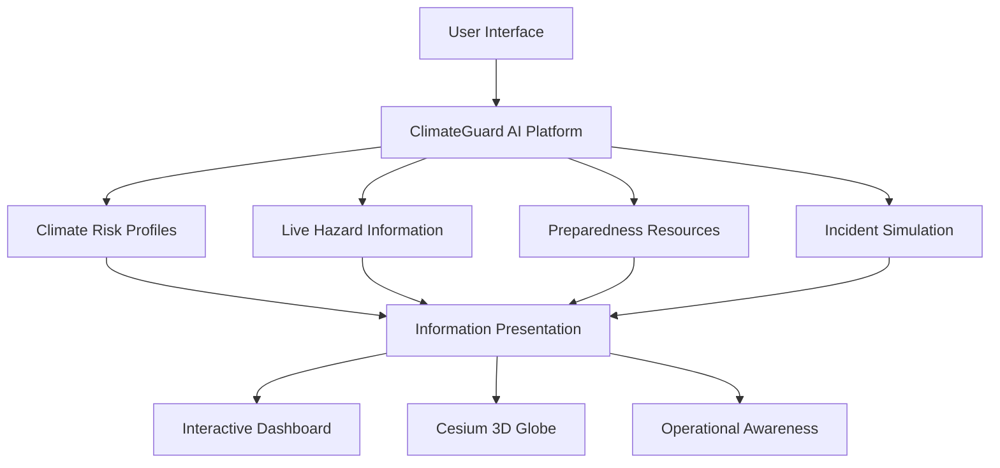
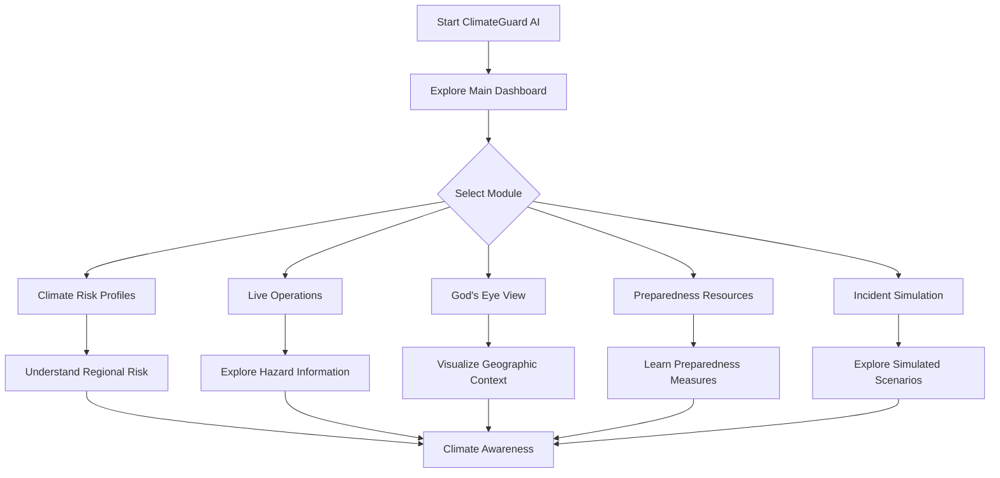

# 🌍 ClimateGuard AI
### AI-Powered Climate Intelligence | Hazard Awareness | Geospatial Monitoring | Disaster Response Simulation

<p align="center">
  
  
  
  
</p>

<p align="center">
  <b>See the Risk. Understand the Climate. Prepare for Tomorrow.</b>
</p>

<p align="center">
  An India-focused climate-hazard education, live situational-awareness, and simulated disaster-response platform designed to make climate information more accessible, understandable, and actionable.
</p>

<p align="center">
  <a href="https://climateguard-ai-ten.vercel.app">
    
  </a>
  <a href="https://climateguard-ai-ten.vercel.app/gods-eye-view/">
    
  </a>
</p>

---

# 📌 Table of Contents

- [🌎 About the Project](#-about-the-project)
- [🎯 Vision and Objectives](#-vision-and-objectives)
- [🌐 Live Deployments](#-live-deployments)
- [✨ Key Features](#-key-features)
- [🛰️ God's Eye View](#️-gods-eye-view)
- [⚙️ System Architecture](#️-system-architecture)
- [🔄 Operational Workflow](#-operational-workflow)
- [🧠 Technology Stack](#-technology-stack)
- [📂 Project Structure](#-project-structure)
- [🚀 Getting Started](#-getting-started)
- [🔐 Environment Configuration](#-environment-configuration)
- [🧪 Testing and Verification](#-testing-and-verification)
- [📚 Documentation](#-documentation)
- [🌱 Real-World Applications](#-real-world-applications)
- [🔮 Future Scope](#-future-scope)
- [⚠️ Disclaimer](#️-disclaimer)

---

# 🌎 About the Project

**ClimateGuard AI** is an India-focused climate intelligence and disaster-preparedness prototype that brings together geospatial visualization, hazard information, climate-risk education, and simulated disaster-response workflows.

The platform aims to bridge the gap between climate-related information and public understanding by presenting relevant information through an interactive digital environment.

Rather than treating climate hazards as isolated events, ClimateGuard AI provides a unified environment for exploring regional risk profiles, understanding hazard information, accessing preparedness guidance, and demonstrating incident-response scenarios.

The platform combines:

- Static regional climate-risk profiles.
- Source-backed hazard information feeds.
- Interactive Cesium-powered 3D Earth visualization.
- Climate-hazard awareness and preparedness resources.
- A separate simulated disaster-response workflow.

**Our goal:** Make climate-risk information easier to explore, understand, and communicate.

---

# 🎯 Vision and Objectives

| Objective | Description |
|---|---|
| Climate Awareness | Improve understanding of climate-related hazards. |
| Geospatial Intelligence | Present geographic information through interactive 3D visualization. |
| Situational Awareness | Provide access to available hazard information. |
| Disaster Preparedness | Communicate safety and preparedness guidance. |
| Response Simulation | Demonstrate incident-management workflows in a controlled environment. |
| Accessibility | Make the platform accessible through web browsers across devices. |

---

# 🌐 Live Deployments

ClimateGuard AI is deployed across two production environments.

| Platform | Main Application | 3D Satellite Console |
|---|---|---|
| AWS Amplify | [Launch Application](https://main.d1f2ku79czevsh.amplifyapp.com) | [Open Satellite View](https://main.d1f2ku79czevsh.amplifyapp.com/gods-eye-view/) |
| Vercel | [Launch Application](https://climateguard-ai-ten.vercel.app) | [Open Satellite View](https://climateguard-ai-ten.vercel.app/gods-eye-view/) |

### Deployment Status

**AWS Amplify**

[](https://main.d1f2ku79czevsh.amplifyapp.com)

**Vercel**

[](https://climateguard-ai-ten.vercel.app)

Both deployments use HTTPS and are intended to support desktop, tablet, and mobile browsers.

---

# ✨ Key Features

## 1. 🌍 Interactive Climate Intelligence Platform

A centralized environment for exploring climate-related information and regional risk profiles.

**Highlights:**
- India-focused climate-hazard awareness.
- Static regional risk profiles.
- Access to available hazard information.
- Centralized user interface.
- Preparedness-oriented information.

## 2. 🛰️ God's Eye View – 3D Satellite Console

An interactive geospatial visualization experience powered by Cesium.

**Highlights:**
- 3D Earth visualization.
- Geographic exploration.
- Satellite-style viewing experience.
- Spatial context for climate-related information.
- Dedicated visualization interface.

🔗 [Explore God's Eye View](https://climateguard-ai-ten.vercel.app/gods-eye-view/)

## 3. 📡 Live Operations Console

A situational-awareness environment that integrates available source-backed hazard information.

**Highlights:**
- Hazard-feed integration.
- Information-based monitoring.
- Regional risk context.
- Operational information presentation.

*The availability and update frequency of information depend on the configured data providers.*

## 4. 🛡️ Climate Education and Preparedness

A dedicated approach to making climate-related hazards easier to understand.

**Highlights:**
- Climate-hazard education.
- Preparedness guidance.
- Risk awareness.
- Information for understanding potential disaster scenarios.

## 5. 🚨 Simulated Disaster-Response Workflow

A demonstration environment for exploring incident-management concepts.

**Highlights:**
- Demonstration incident workflows.
- Simulated response scenarios.
- Separation between educational simulations and live hazard information.
- Controlled demonstration environment.

---

# 🛰️ God's Eye View

The God's Eye View module introduces a three-dimensional geospatial perspective to the ClimateGuard AI platform.

Powered by Cesium, it provides an interactive environment for exploring the Earth and understanding geographic context.

**Open the 3D Satellite Console:**

[](https://climateguard-ai-ten.vercel.app/gods-eye-view/)

---

# ⚙️ System Architecture

ClimateGuard AI follows a modular platform architecture.



### Architecture Components

| Component | Responsibility |
|---|---|
| Frontend | User interaction and platform interface |
| Geospatial Layer | 3D Earth visualization using Cesium |
| Risk Information Layer | Static regional risk profiles |
| Hazard Information Layer | Source-backed hazard feeds |
| Education Layer | Climate awareness and preparedness guidance |
| Simulation Layer | Demonstration incident workflows |
| Deployment Layer | AWS Amplify and Vercel hosting |

---

# 🔄 Operational Workflow



---

# 🧠 Technology Stack

ClimateGuard AI brings together modern web technologies and geospatial visualization tools.

| Technology | Purpose |
|---|---|
| Cesium | 3D geospatial visualization |
| JavaScript | Application functionality |
| HTML5 | Web structure |
| CSS3 | Interface styling |
| Node.js | JavaScript runtime and tooling |
| npm | Dependency management |
| AWS Amplify | Cloud deployment |
| Vercel | Cloud deployment |

*The table identifies technologies described in the project overview and deployment information. Refer to the repository's package configuration for the complete dependency inventory.*

---

# 📂 Project Structure

```text
ClimateGuard-AI/
│
├── public/
│
├── src/
│   ├── components/
│   ├── pages/
│   ├── assets/
│   └── ...
│
├── docs/
│   ├── LIVE_OPERATIONS.md
│   ├── CESIUM_SETUP.md
│   ├── CHATBOT_SETUP.md
│   └── THIRD_PARTY_NOTICES.md
│
├── .env.example
├── package.json
└── README.md
```

*Illustrative structure; refer to the actual repository for the complete directory layout.*

---

# 🚀 Getting Started

Follow these steps to run ClimateGuard AI locally.

### Prerequisites

- Node.js
- npm
- Git
- A modern web browser

### 1. Clone the Repository

```bash
git clone YOUR_REPOSITORY_URL
```

### 2. Navigate to the Project Directory

```bash
cd ClimateGuard-AI
```

### 3. Install Dependencies

```bash
npm install
```

### 4. Start the Development Server

```bash
npm run dev
```

### 5. Open the Application

Visit:

```text
http://localhost:5173
```

Choose **Live Operations** to explore the near-real-time information console.

---

# 🔐 Environment Configuration

Some integrations may require provider-specific configuration.

The project includes:

```text
.env.example
```

Review this file to understand the optional configuration variables.

**Security Guidelines:**

- Never commit private API keys.
- Never expose server-side secrets in frontend code.
- Keep `.env.local` out of version control.
- Use environment variables through the appropriate deployment configuration.
- Follow the individual provider's security requirements.

---

# 🧪 Testing and Verification

Run the following commands from the project root.

### Run Tests

```bash
npm test
```

### Run Linting

```bash
npm run lint
```

### Build Production Version

```bash
npm run build
```

These commands help verify application functionality, code quality, and production-build compatibility.

---

# 📚 Documentation

Explore the technical documentation:

| Documentation | Description |
|---|---|
| [Live Operations Setup](docs/LIVE_OPERATIONS.md) | Setup and limitations of the live operations module |
| [Cesium Setup](docs/CESIUM_SETUP.md) | Configuration of the 3D geospatial environment |
| [AI Chatbot Setup](docs/CHATBOT_SETUP.md) | AI chatbot configuration |
| [Third-Party Notices](docs/THIRD_PARTY_NOTICES.md) | Data sources, dependencies, and code notices |

---

# 🌱 Real-World Applications

ClimateGuard AI demonstrates concepts that can support several climate-awareness and disaster-preparedness use cases.

- **Educational Institutions:** Climate awareness and disaster-preparedness demonstrations.
- **Climate Research:** Exploration of geographic risk information.
- **Community Awareness:** Understanding regional climate hazards.
- **Disaster Preparedness:** Communicating preparedness concepts.
- **Geospatial Learning:** Demonstrating the use of 3D Earth visualization.
- **Technology Demonstrations:** Exploring the integration of hazard information and incident simulations.

---

# 🔮 Future Scope

Potential future development directions include:

- AI-assisted climate-risk analysis.
- Expanded geographic hazard coverage.
- Additional verified environmental data integrations.
- Improved historical climate-data visualization.
- Advanced geospatial analytics.
- Interactive regional risk comparisons.
- More comprehensive disaster-response simulations.
- Multilingual climate-awareness resources.
- Enhanced accessibility and mobile experience.

These are proposed improvements, not claims about currently implemented features.

---

# ⚠️ Disclaimer

ClimateGuard AI is an educational and local demonstration prototype.

- It is not connected to official emergency-response services.
- Simulated incidents do not represent actual emergencies.
- Hazard information depends on configured external data sources.
- Static risk profiles should not be interpreted as live forecasts.
- Information displayed by the platform may be incomplete, delayed, or subject to source limitations.
- This platform must not be used as the sole source for emergency response or safety decisions.

For actual emergencies, always follow official government advisories and contact the appropriate emergency services.

---

# 🌍 Our Mission

We believe technology can make climate information more accessible and understandable.

ClimateGuard AI explores how geospatial visualization, climate education, hazard information, and simulation-based learning can come together in one unified digital platform.

**Understand the Environment. Explore the Risks. Build a More Prepared Future.**

<p align="center">
  <b>🌍 ClimateGuard AI — Making Climate Intelligence More Accessible.</b>
</p>

<p align="center">
  <a href="https://climateguard-ai-ten.vercel.app">Live Platform</a> •
  <a href="https://climateguard-ai-ten.vercel.app/gods-eye-view/">3D Satellite Console</a> •
  <a href="https://main.d1f2ku79czevsh.amplifyapp.com">AWS Deployment</a>
</p>
